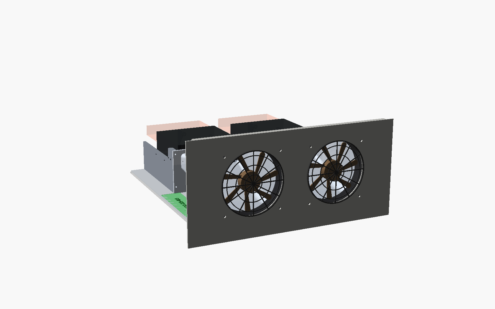
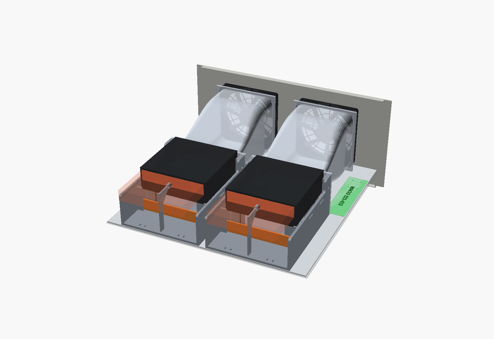
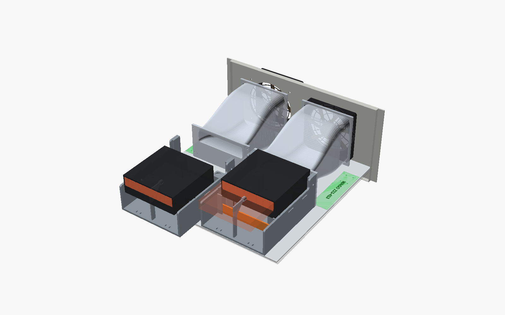
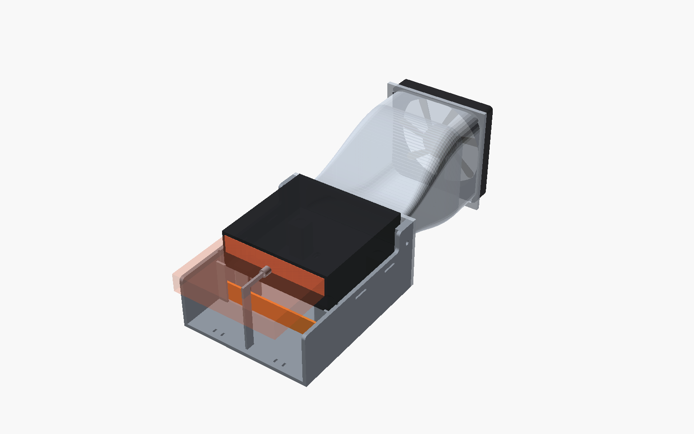
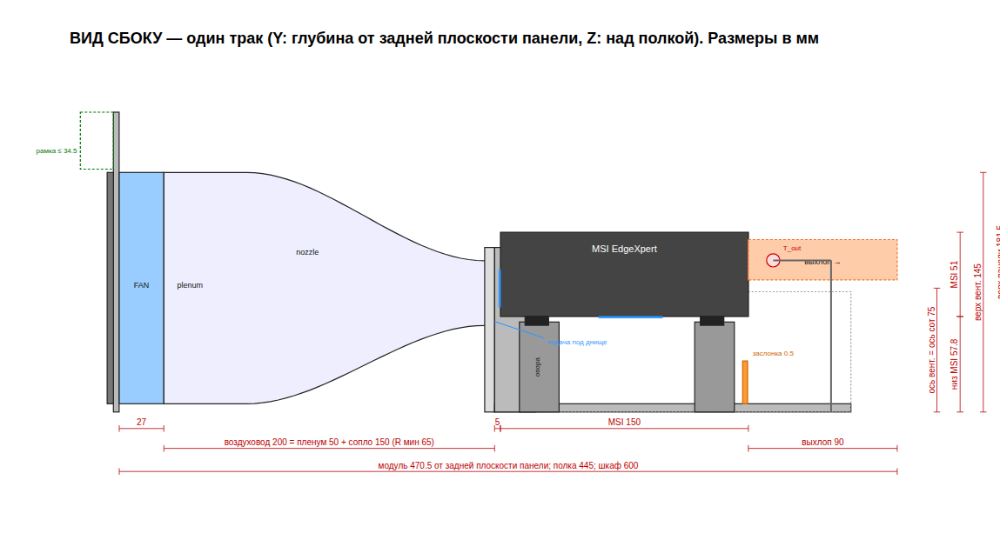
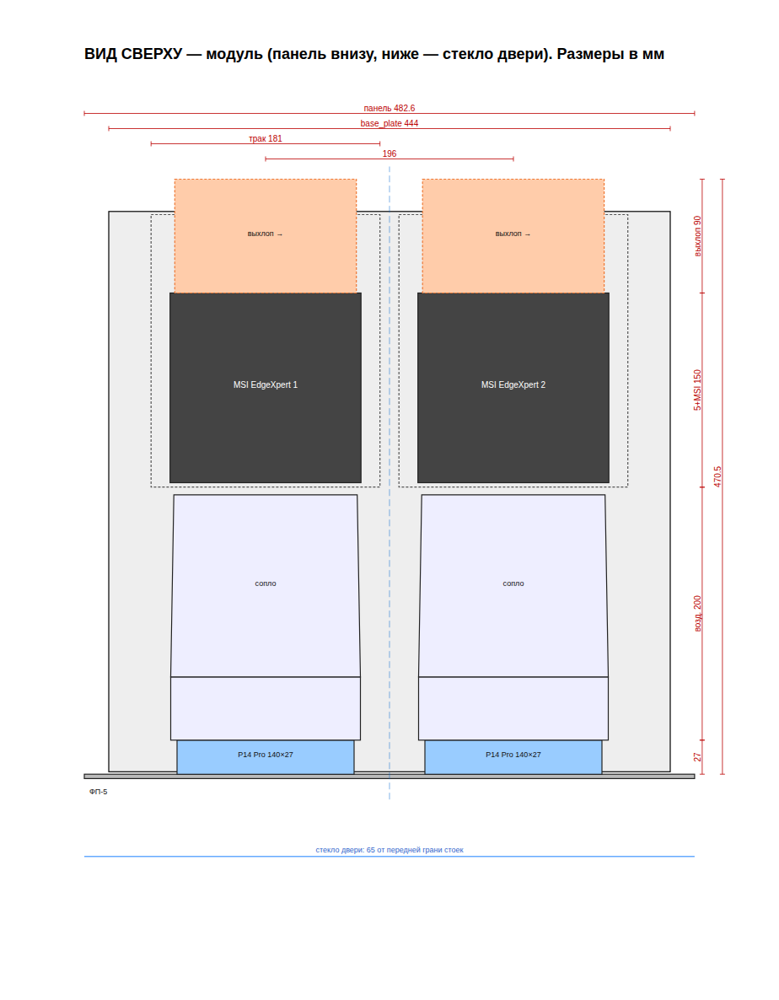
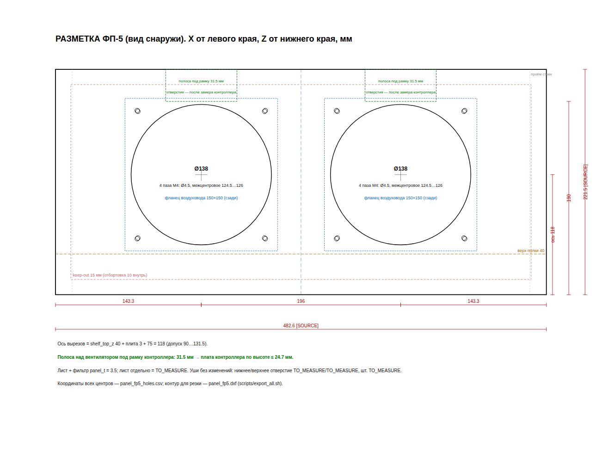

# dual-spark-4u — 5U-модуль с 2 × MSI EdgeXpert AI (DGX Spark-class) и раздельным охлаждением для 18U шкафа

Параметрический OpenSCAD-проект самостоятельного 5U-узла: фронтальная панель
ЦМО ФП-5 с двумя вырезами под 140-мм вентиляторы, алюминиевая base_plate на
полке шкафа, два holder'а (адаптация
[alexliesenfeld/dgx-spark-printables](https://github.com/alexliesenfeld/dgx-spark-printables),
CC BY-NC 4.0), два независимых воздуховода 140 → передняя решётка MSI, свободный
выхлоп в горячую зону шкафа. Имя репозитория историческое: v1 проектировалась
под 4U-корпус (`docs/TZ_v1_chassis.md`), v2 — модуль в шкафу (`docs/TZ.md`).

```
[решётка ARCTIC 140] → [ФП-5] → [Arctic P14 Pro PST 27] → [воздуховод 200 = пленум 50 + сопло 150]
    → [EPDM 5] → [MSI 150] → [выхлоп ≥ 90]          × 2 тракта, оси x = ±98 от центра панели
```

## Статус: замеры внесены — панель, плита, holder и воздуховод готовы к изготовлению

Замеры раундов 1+2 (шкаф, ФП-5, MSI, вентилятор, решётка) внесены в
`scad/params.scad` (`docs/08_measurements.md`). Модуль собирается целиком.
Экспортированы окончательные STL holder'а, воздуховода (два варианта),
заслонок (уголки panel↔плита не печатаются — крепление через штатные
отверстия), DXF и таблицы отверстий для резки панели ФП-5 и сверловки
плиты. Ждут замера только рамка термоконтроллера (п.11) и стойка DC-гнезда
(п.15); их STL появятся автоматически после внесения размеров.

**Важно:** полоса над вентилятором под рамку контроллера — 31.5 мм, плата
должна быть не выше 24.7 мм (варианты — `docs/03_measure_checklist.md`).

| Документ | Что |
|----------|-----|
| `docs/TZ.md` | ТЗ v2 + дополнение v3 (§10, решения по замерам) |
| `CLAUDE.md` | решения, открытые вопросы, журнал |
| `docs/01_analysis.md` | MSI EdgeXpert (источники + замеры), исходник holder'а, опыт сообщества |
| `docs/02_layout.md` | размерная схема модуля, координаты, проверки |
| `docs/03_measure_checklist.md` | что ещё измерить и варианты для контроллера |
| `docs/04_aero_estimate.md` | расход, P14 Pro PST, сужение 5:1, подача под днище, приток |
| `docs/05_bom_hardware.md` | печатные/покупные части, крепёж (M4×40) |
| `docs/06_dimensions.md` | таблица размеров |
| `docs/07_rack_layout.md` | раскладка 18U, холодная/горячая зона, датчики, установка/снятие |
| `docs/08_measurements.md` | сводка замеров и как они попали в модель |
| `docs/09_print_materials.md` | пластики, температуры деталей, режимы и параметры печати |
| `docs/drawings/` | `panel_fp5`, `base_plate` (SVG/PNG/DXF/CSV), `side_view`, `top_view` |
| `docs/drawings/fan_template_fp5_A4.pdf` | шаблон разметки вырезов вентиляторов на ФП-5, 1:1, 2 листа A4 |
| `docs/renders/` | 3D-рендеры |
| `stl/assembly_module_VIEW_ONLY.stl` | весь модуль в 3D (GitHub показывает STL в браузере) |

## Эскизы

Все картинки пересобираются из `scad/params.scad` скриптом
`./scripts/export_all.sh` — это текущее состояние модели.

| Спереди: ФП-5, решётки, вентиляторы | Сзади: воздуховоды, holder'ы, MSI |
|---|---|
|  |  |
| **Разнесённый вид** (один тракт разнесён) | **Один тракт** |
|  |  |



| Вид сверху | Разметка ФП-5 (вид снаружи) |
|---|---|
|  |  |

Что означают цвета на 3D-рендерах:

| Цвет | Что это |
|------|---------|
| светло-серый лист с отбортовкой | панель ЦМО ФП-5 (на виде спереди — тёмная) |
| чёрные кольца со спицами | решётки ARCTIC 140 снаружи панели |
| полупрозрачный голубой | воздуховод (пленум + сопло) |
| серый | holder (опоры, стенки, стойка T_out) |
| чёрный корпус с голубой и оранжевой полосой | макет MSI EdgeXpert: голубое — соты (вход), оранжевое — задний выхлоп |
| оранжевая планка | заслонка `bypass_block` в пазах holder'а (для испытаний) |
| розовый полупрозрачный объём | зона свободного выхлопа ≥ 90 мм за MSI — воздух, не деталь |
| зелёная площадка с надписью | место на плите под WAGO 221-413 (слева) и DC-гнездо 12 В (справа) — не деталь, не печатается |
| светло-серая плита | base_plate 444 × 443 × 3 Al |

На виде сбоку зелёный пунктир над панелью — полоса 31.5 мм под рамку
термоконтроллера (появится после замера контроллера).

## Ключевые размеры

| | мм |
|---|---|
| Трак / шаг / пара | 181 / 196 / 377 |
| Модуль от передней грани стоек | 472 (полка 445, шкаф 600) |
| Ось вентилятора = центр сот MSI | 78 над полкой, 118 от нижнего края панели |
| Вырезы панели | 2 × Ø138 на 143.3 и 339.3 от левого края; пазы M4 124.5…126 |
| Воздуховод | 135.2² → 140.2 × 34.4 (26.4 на соты + 8 под днище), пленум 50 + сопло 150, R мин 65 |
| base_plate | 444 × 443 × 3 Al |
| Болт сэндвича | M4×40 |
| Полоса под рамку контроллера | 31.5 (плата ≤ 24.7 по высоте) |

## Файлы

```
scad/params.scad          все параметры [MEAS]/[SRC]/[ASSM]/TO_MEASURE(undef), производные, проверки, msi()
scad/derived.scad         печать производных размеров для чертежей
scad/lib/shapes.scad      примитивы, лофт, макеты
scad/edgexpert_holder.scad  holder (part=holder|holder_with_device|baffle|holder_with_baffle)
scad/duct.scad            воздуховод (part=duct|duct_a|duct_b|duct_section)
scad/front_panel.scad     ФП-5 с вырезами (part=panel|panel_2d)
scad/base_plate.scad      base_plate, panel_bracket, dc_jack_bracket (требует dc_jack_d)
scad/ctrl_bezel.scad      рамка термоконтроллера на лицевой стороне ФП-5 (требует ctrl_w/h/d)
scad/assembly.scad        модуль (part=module|exploded|track|printables)
scad/fan_bracket.scad     ОПЦИЯ: рамка для настольного стенда
stl/                      печатные детали, двоичный STL (экспорт по зависимостям каждой детали)
stl/kit/                  тестовый комплект на один тракт: 2 стола 330 × 320
scad/print_plates.scad    раскладка тестового комплекта (part=kit_1|kit_2)
stl/assembly_*_VIEW_ONLY.stl  весь модуль одним файлом и разнесённый вид — только для просмотра
scripts/export_assembly_view.py  склейка сборки по группам деталей
scripts/export_all.sh     STL, DXF, рендеры, чертежи; OK/SKIP по каждой детали
scripts/make_drawings.py  чертежи и таблицы отверстий
```

## Как пользоваться

1. `./scripts/export_all.sh` — пересобирает всё; в выводе OK/SKIP по деталям.
2. Панель: вырезы и пазы по `docs/drawings/panel_fp5.dxf` или
   `panel_fp5_holes.csv`; вручную — шаблон 1:1 `fan_template_fp5_A4.pdf`
   (печать «Фактический размер», совместить края панели, кернить через бумагу). Плита: `base_plate.dxf` / `base_plate_holes.csv`.
3. Печать по `docs/05_bom_hardware.md` (PETG прототип, ASA финал), сборка по
   `docs/07_rack_layout.md` §5.
4. Когда придут контроллер и DC-гнездо — вписать `ctrl_w/h/d` и `dc_jack_d`
   в `scad/params.scad` и снова запустить экспорт.

## Лицензия

Производная работа от dgx-spark-printables (CC BY-NC 4.0, Alexander Liesenfeld) —
на тех же условиях, некоммерчески, с указанием автора исходника.
